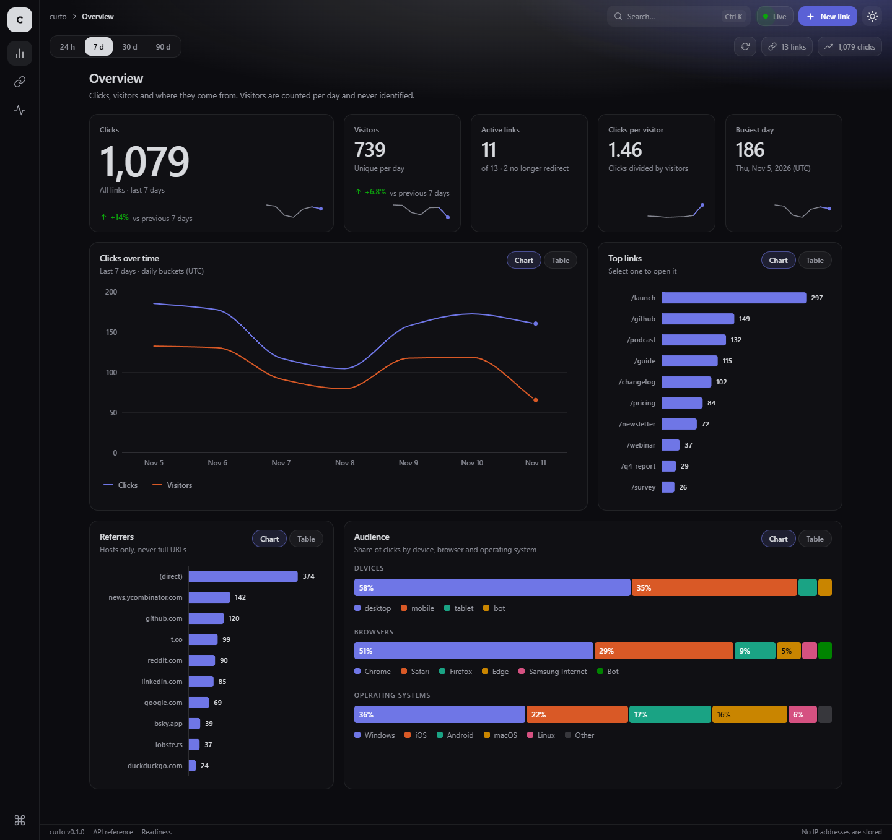
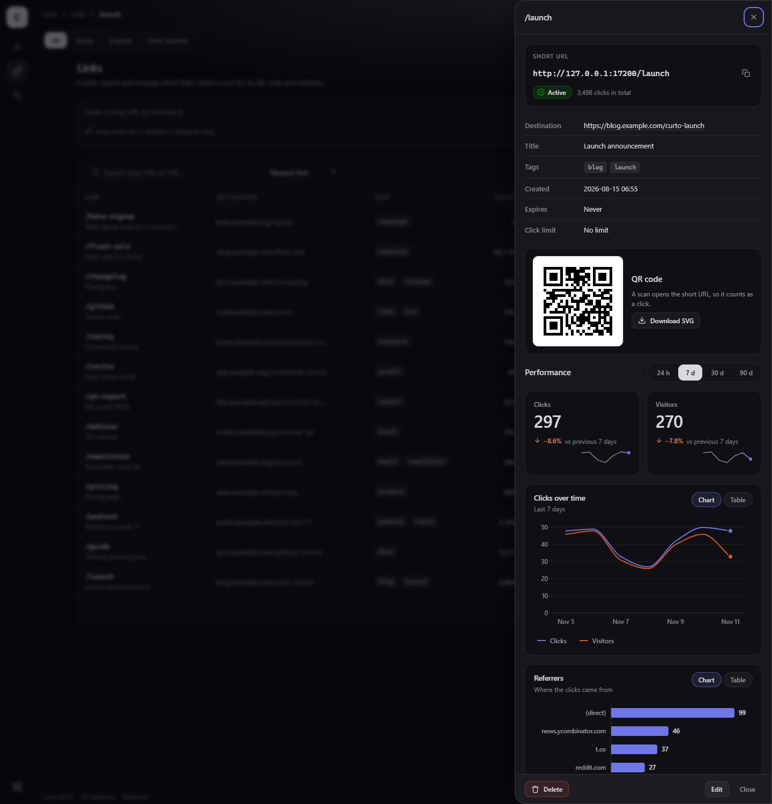
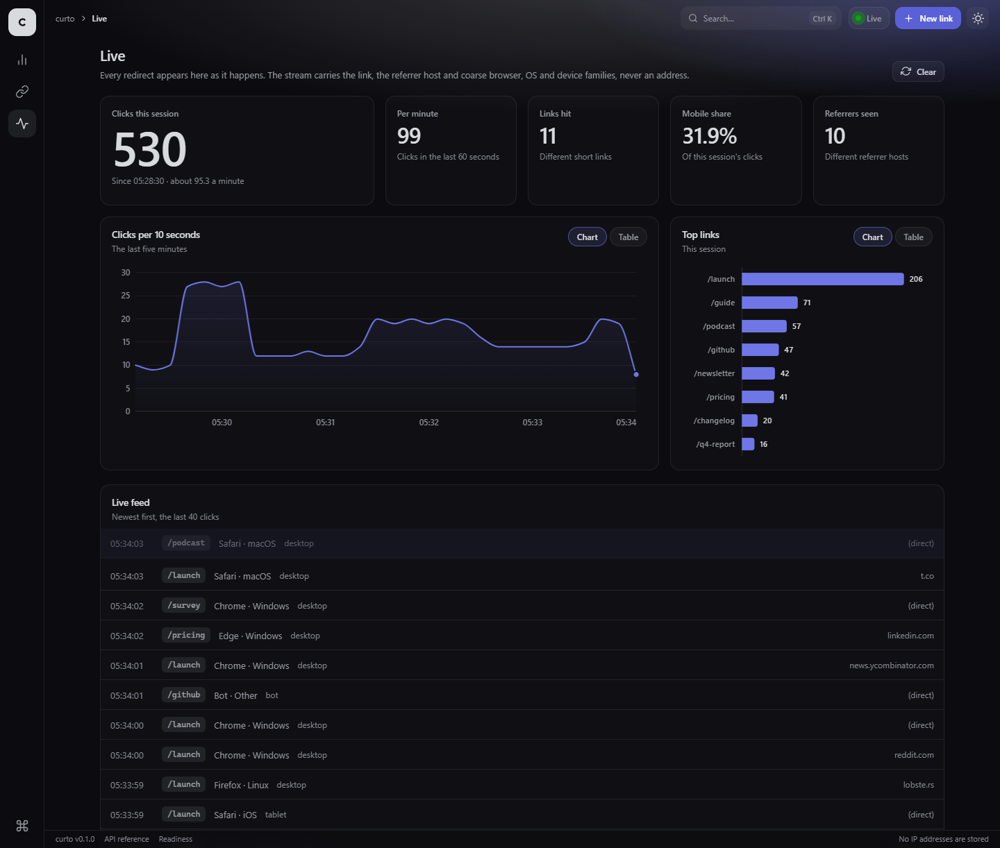
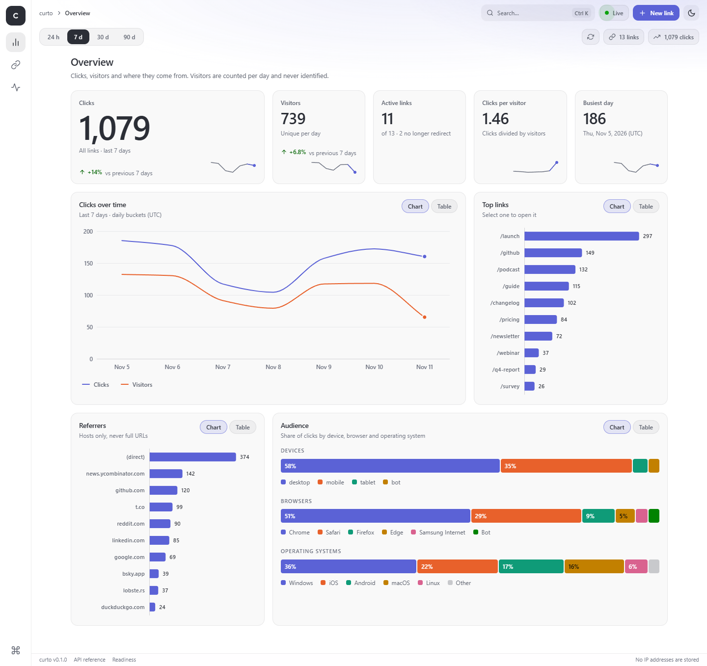
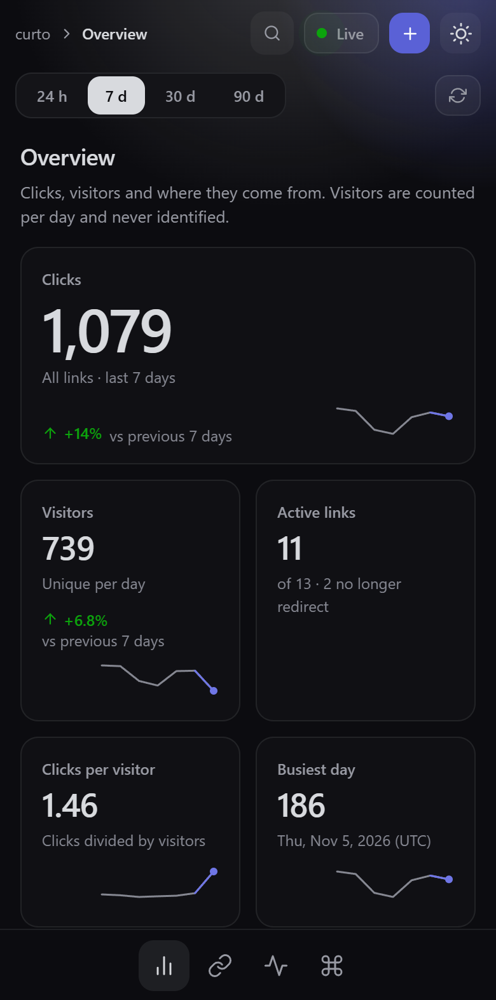
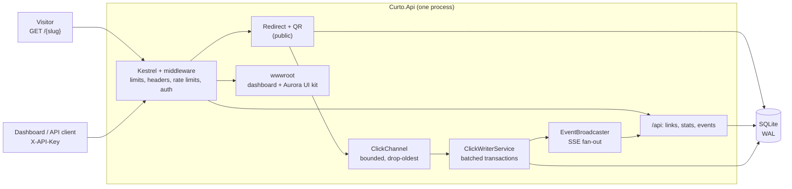

<p align="center"></p>

<p align="center">
  <b>A self-hosted URL shortener that shows what is happening right now, without storing who is doing it.</b>
</p>

<p align="center">
  
  
  
  <a href="https://github.com/q6r/curto/actions/workflows/ci.yml"></a>
</p>

<p align="center">English · <a href="README.pt-BR.md">Português</a></p>

<p align="center"></p>

## Why curto

- **Privacy by construction.** No IP address, no raw User-Agent, no cookie is ever stored. A visitor is a 64-bit hash
  that is salted with a random value that changes every UTC day and never touches the disk, so it cannot be linked
  across days or recomputed later. What is kept is written down in [docs/privacy.md](docs/privacy.md).
- **Live, not "yesterday's numbers".** Every redirect appears in the dashboard within a fraction of a second through
  a Server-Sent Events stream, and the redirect itself never waits for the click to be written.
- **Small enough to trust.** One ASP.NET Core 9 process, one SQLite file, no broker and no cache server. A strict
  Content Security Policy with no inline script or style, API-key auth with constant-time comparison, per-client rate
  limits, and a test suite that covers the unhappy paths.

## Features

- **Short links.** Random 7-character or custom slugs, titles, tags, expiry dates and click budgets ("valid for 100
  clicks"), JSON merge-patch updates, scalable QR codes as SVG.
- **Analytics.** Clicks and daily visitors for the last 24 hours, 7, 30 or 90 days, compared with the period before,
  plus referrers, browsers, operating systems and devices. Per link or across all links.
- **Live view.** A click stream over SSE with heartbeats, back-pressure and protection against slow consumers. The
  dashboard reads it with `fetch()` and reconnects with exponential back-off.
- **Dashboard.** A responsive single-page app built on the bundled Aurora UI kit, with no build step and no external
  request: a navigation rail on the left, breadcrumbs, search and the live state on top, a sub bar with the controls
  of the current view, flat cards on one ground and a status bar, in the Prism Classic palette (Prism Daylight in the
  light theme). *Overview*: a range switch, key figures with change indicators, clicks over time, top links,
  referrers and the audience mix. *Links*: paste a URL to shorten it, search, filter by status or tag, sort and page
  through the API, create, edit and delete, and a drawer per link with its QR code and charts. *Live*: counters, a
  chart and a feed that move as clicks arrive. Dark and light themes, a command palette (`Ctrl+K`), a table view
  behind every chart, keyboard accessible, 360 px and up.
- **A clean API.** OpenAPI document and the Scalar reference at `/docs`, RFC 9457 problem documents for every error,
  field-level validation messages.
- **Operations.** `/healthz` and `/readyz` (with click-pipeline counters), graceful shutdown that drains queued
  clicks, nightly retention cleanup, a non-root Docker image with a read-only root file system.

<p align="center">
  
  
</p>
<p align="center">
  
  
</p>

## Quick start

You need the [.NET 9 SDK](https://dotnet.microsoft.com/download/dotnet/9.0). Nothing else.

```bash
git clone https://github.com/q6r/curto.git && cd curto
```

Start the server with an API key (16 to 256 characters). On macOS and Linux:

```bash
export CURTO_API_KEY="$(openssl rand -base64 32)"
export ASPNETCORE_URLS=http://127.0.0.1:5080
dotnet run --project src/Curto.Api
```

On Windows PowerShell:

```powershell
$bytes = New-Object byte[] 32; [Security.Cryptography.RandomNumberGenerator]::Create().GetBytes($bytes)
$env:CURTO_API_KEY = [Convert]::ToBase64String($bytes)
$env:ASPNETCORE_URLS = "http://127.0.0.1:5080"
dotnet run --project src/Curto.Api
```

```text
2026-11-10 22:16:34 info: Curto.Api.Storage.Database[10] Database schema is at version 1
2026-11-10 22:16:34 info: Microsoft.Hosting.Lifetime[14] Now listening on: http://127.0.0.1:5080
2026-11-10 22:16:34 info: Microsoft.Hosting.Lifetime[0] Application started. Press Ctrl+C to shut down.
```

Open <http://127.0.0.1:5080/>, paste the key when the dashboard asks for it (it stays in `sessionStorage` and is
never written anywhere else), and create your first link. The interactive API reference is at
<http://127.0.0.1:5080/docs>. The SQLite file is created at `src/Curto.Api/data/curto.db`; point `CURTO_DB_PATH`
somewhere else if you prefer.

Want charts that are not empty? In a second terminal, run a seed script with the same key. It creates a dozen links
and simulates varied visits (browsers, devices, referrers, returning visitors, a link that runs out of clicks, one that
expires) through the real HTTP API:

```bash
CURTO_API_KEY="<the key>" ./examples/seed.sh http://127.0.0.1:5080 100
```

```powershell
$env:CURTO_API_KEY = "<the key>"; ./examples/seed.ps1 -BaseUrl http://127.0.0.1:5080 -Clicks 100
```

The default limit is 120 redirects per minute per client address, so the script waits whenever the server says
`429`. Start the server with `CURTO_RATE_LIMIT_REDIRECT_PER_MINUTE=100000` to seed instantly. Visits are always
stamped "now"; [`examples/`](examples) also has a small tool that backdates a demo database with 90 days of history,
which is how the screenshots above were made.

**Run a published build** (what the container does):

```bash
dotnet publish src/Curto.Api -c Release -o out
cd out && CURTO_API_KEY="<the key>" ASPNETCORE_URLS=http://127.0.0.1:5080 dotnet Curto.Api.dll
```

A `Dockerfile` and a `docker-compose.yml` are included (chiseled non-root image, read-only root file system, a volume
for the SQLite file, a health check that needs no `curl`). CI builds the image and probes it on every push; see the
comments at the top of the compose file. Putting curto behind a TLS-terminating proxy needs two settings, described in
[docs/reverse-proxy.md](docs/reverse-proxy.md).

## Usage

Everything under `/api` needs the key in an `X-API-Key` header. The redirect, the QR code and the health probes are
public. The examples below come from a real run of [`examples/curl.sh`](examples/curl.sh) (and
[`curl.ps1`](examples/curl.ps1), [`curto.http`](examples/curto.http)); [docs/api.md](docs/api.md) is the quick tour of
every endpoint and convention.

**Create a link**

```bash
curl -s -X POST $BASE/api/links -H "X-API-Key: $CURTO_API_KEY" -H "Content-Type: application/json" \
    -d '{"url":"https://example.com/blog/hello-world","slug":"tour","title":"Guided tour","tags":["blog","demo"]}'
```

```json
{"slug":"tour","shortUrl":"http://127.0.0.1:5080/tour","url":"https://example.com/blog/hello-world","title":"Guided tour","tags":["blog","demo"],"createdAt":"2026-11-11T01:14:15Z","expiresAt":null,"maxClicks":null,"clicks":0,"status":"active"}
```

**Follow it.** The answer is a `302` that is never cached; the click is recorded in the background.

```bash
curl -s -i $BASE/tour -H "Referer: https://news.ycombinator.com/item?id=1"
```

```text
HTTP/1.1 302 Found
Cache-Control: no-store
Location: https://example.com/blog/hello-world
```

**Mistakes are explained per field** (`400`; a taken slug is a `409` with `"code":"slug_taken"`; no key is a `401`):

```json
{"type":"https://tools.ietf.org/html/rfc9110#section-15.5.1","title":"One or more validation errors occurred.","status":400,"detail":"See the errors member for details.","instance":"/api/links","errors":{"url":["url must be an absolute http or https URL."],"slug":["slug must be 3-32 characters from A-Z, a-z, 0-9, '_' and '-'."],"tags":["each tag must be 1-32 letters, digits, '-', '_', '.' or ':'."]},"traceId":"00-4ef4d7e613a2392cbbc1c77cabbb991f-a24fa9ebe98e9ed1-00","correlationId":"01a1c82b7d0777e19d49babaea082ad8"}
```

**Update with a JSON merge patch** (present fields change, `null` clears, absent fields stay):

```bash
curl -s -X PATCH $BASE/api/links/tour -H "X-API-Key: $CURTO_API_KEY" -H "Content-Type: application/json" \
    -d '{"title":"Guided tour (edited)","maxClicks":50}'
```

**Statistics.** `range` is `24h`, `7d`, `30d` or `90d`; the series is zero-filled and the response carries the same
numbers for the window before, which is what the dashboard's deltas come from (the series is elided here):

```bash
curl -s "$BASE/api/links/tour/stats?range=24h" -H "X-API-Key: $CURTO_API_KEY"
```

```json
{"range":{"from":"2026-11-10T02:00:00Z","to":"2026-11-11T02:00:00Z","bucket":"hour"},"links":{"total":1,"active":1,"expired":0},"clicks":{"inRange":1,"previous":0},"visitors":{"inRange":1,"previous":0},"series":[…],"topLinks":[{"slug":"tour","title":"Guided tour (edited)","url":"https://example.com/blog/hello-world","clicks":1}],"referrers":[{"name":"news.ycombinator.com","clicks":1}],"devices":[{"name":"desktop","clicks":1}],"browsers":[{"name":"Firefox","clicks":1}],"os":[{"name":"Linux","clicks":1}]}
```

**Watch clicks arrive.** `EventSource` cannot send headers, so read the stream with `curl -N` or `fetch()`:

```bash
curl -N -H "X-API-Key: $CURTO_API_KEY" $BASE/api/events
```

```text
retry: 5000
: connected

event: click
data: {"slug":"hello","at":"2026-11-11T01:10:51.629018Z","referrer":"linkedin.com","browser":"Safari","os":"iOS","device":"mobile"}
```

There is no field that could carry an address, and the visitor hash is not part of the event.

**Health and the click pipeline** (`GET /readyz`, public):

```json
{"status":"ready","version":"0.1.0","database":"ok","clickQueue":{"depth":0,"capacity":10000,"enqueued":2,"persisted":2,"dropped":0,"failed":0},"liveSubscribers":0,"slowConsumersDropped":0}
```

### Endpoints

| Method and path | Auth | What it does |
|---|---|---|
| `GET /{slug}` | public | `302` to the target, or `404` / `410` (expired, click limit reached). Records a click. |
| `HEAD /{slug}` | public | Same answer, records nothing (link checkers and previews). |
| `GET /qr/{slug}.svg` | public | QR code of the short URL. `size` 64-2048, `dark` and `light` as hex colours. |
| `POST /api/links` | key | Create a link (`url`, optional `slug`, `title`, `tags`, `expiresAt`, `maxClicks`). |
| `GET /api/links` | key | List: `query`, `tag`, `status`, `sort` (`createdAt`, `clicks`), `dir`, `limit` (1-200), `offset`. |
| `GET /api/links/{slug}` | key | One link. |
| `PATCH /api/links/{slug}` | key | JSON merge patch. The slug itself cannot change. |
| `DELETE /api/links/{slug}` | key | Delete the link and its click rows. |
| `GET /api/stats/overview` | key | Analytics across all links. |
| `GET /api/links/{slug}/stats` | key | Analytics of one link, same shape. |
| `GET /api/events` | key | Live click stream (SSE). |
| `GET /healthz`, `GET /readyz` | public | Liveness, and readiness with pipeline counters. |
| `GET /docs`, `GET /openapi/v1.json` | public | Scalar API reference and the OpenAPI document. |

## Architecture



A redirect does one indexed read and one non-blocking channel write, then answers. A background writer batches
events into single transactions and pushes each one to live subscribers. When the writer falls behind, the oldest
queued event is dropped and counted in `/readyz`; the visitor never notices. The full story, with sequence diagrams
for the click pipeline and the live stream, is in [docs/architecture.md](docs/architecture.md).

## Project layout

```text
curto/
├── src/Curto.Api/             the service (ASP.NET Core 9, minimal APIs)
│   ├── Endpoints/             route groups: links, stats, events, redirect, QR, health
│   ├── Services/              use cases, click pipeline, parsers, validators
│   ├── Storage/               SQLite access and schema migrations
│   ├── Infrastructure/        options, auth, rate limits, security headers, problem documents
│   ├── Models/                DTOs and domain records
│   └── wwwroot/               the dashboard: index.html, app.js, app.css and the bundled Aurora UI kit
├── tests/Curto.Api.Tests/     xUnit: API, security, privacy, SSE, click pipeline, dashboard assets
├── examples/                  .http file, curl tours, seed scripts, Curto.DemoHistory (backdated demo data)
├── docs/                      architecture, configuration, privacy, API tour, reverse proxy, screenshots
├── assets/banner.svg
├── Dockerfile  docker-compose.yml  .dockerignore
└── .github/                   CI, Dependabot, issue and pull request templates
```

## Configuration

Settings come from `appsettings.json`, `Curto__Name` environment variables and the friendly `CURTO_*` aliases below.
Every option, its range and its default is in [docs/configuration.md](docs/configuration.md); a bad value stops the
process at start-up and the error names every problem.

| Environment variable | Default | Meaning |
|---|---|---|
| `CURTO_API_KEY` | none | **Required** outside Development. 16-256 printable characters. Sent as `X-API-Key`. |
| `CURTO_BASE_URL` | derived from the request | Public origin for short URLs, for example `https://s.example.com`. Set it in production. |
| `CURTO_DB_PATH` | `data/curto.db` | SQLite file. Its directory must be writable (WAL mode adds `-wal` and `-shm` files). |
| `CURTO_BLOCK_PRIVATE_TARGETS` | `false` | Refuse targets on loopback, private or local-only hosts. |
| `CURTO_RETENTION_DAYS` | `180` | Click rows older than this are pruned nightly. Lifetime counters stay. |
| `CURTO_RATE_LIMIT_REDIRECT_PER_MINUTE` | `120` | Per client address: redirects and QR codes. |
| `CURTO_RATE_LIMIT_CREATE_PER_MINUTE` | `20` | Per client address: link creation. |
| `CURTO_RATE_LIMIT_API_PER_MINUTE` | `300` | Per client address: every other `/api` call. |
| `ASPNETCORE_URLS` | `http://localhost:5000` | Where Kestrel listens. Bind to loopback unless a proxy needs more. |

## Security notes

- **Auth.** One shared API key in the `X-API-Key` header, never in a query string. The candidate and the expected key
  are SHA-256 hashed and then compared in constant time. The dashboard keeps the key in `sessionStorage` only.
- **Browser hardening.** `Content-Security-Policy: default-src 'self'; script-src 'self'; style-src 'self'` on the
  dashboard and the API, `nosniff`, `X-Frame-Options: DENY`, a strict `Referrer-Policy`, no CORS headers at all.
  Only `/docs` gets a per-request nonce and a style exception, because the Scalar bundle injects styles. The
  dashboard never builds markup from data (all text goes through `textContent`), and tests fail if it grows inline
  script, inline style or a request to another origin.
- **Input.** Target URLs must be absolute `http(s)`, at most 2048 characters, without credentials, and are normalised
  to ASCII. Slugs are 3-32 characters from `A-Za-z0-9_-` and the words that collide with routes are reserved. Unknown
  JSON properties are rejected, request bodies are capped (16 KiB by default), SQL is parameterised throughout.
- **Abuse.** Fixed-window rate limits per client address (IPv6 per /64). `CURTO_BLOCK_PRIVATE_TARGETS=true` refuses
  targets that point at loopback, private or local-only addresses.
- **Honest limits.** curto does not terminate TLS: put a reverse proxy in front of it and read
  [docs/reverse-proxy.md](docs/reverse-proxy.md) so that rate limits and visitor hashes see the real client address.
  There is one key and no user accounts. `BLOCK_PRIVATE_TARGETS` looks at literal addresses and well-known local
  names; it never resolves DNS, so a public name that resolves to a private address is not caught.

Report vulnerabilities privately as described in [SECURITY.md](SECURITY.md).

## Testing

```bash
dotnet build Curto.slnx -c Release -warnaserror
dotnet test Curto.slnx -c Release
dotnet format Curto.slnx --verify-no-changes
```

681 tests, offline, about five seconds. The real application is hosted in memory with an isolated SQLite file per
test class, a fake clock and fast click flushing. Beyond the happy paths the suite covers validation and hostile
input, authentication, rate limiting, security headers, privacy (nothing identifying reaches the database), expiry and
click budgets under concurrency, the click pipeline and its overflow behaviour, graceful shutdown, retention, SSE, and
the static dashboard layer: content types, revalidating cache headers, the strict policy, no inline code, no external
origin, that the page leaves its landmarks to `Aurora.shell()` and every rail destination has a view, and that every
API path the dashboard calls exists in the OpenAPI document.

The dashboard itself has no JavaScript unit tests. It was exercised in headless Chrome (create, edit and delete a
link, a live stream that survives a server restart, light and dark themes, 360 px to 1440 px).

## Roadmap

- More than one API key, with labels and rotation.
- A list of trusted proxies instead of the all-or-nothing `ASPNETCORE_FORWARDEDHEADERS_ENABLED` switch.
- CSV and JSON export of the aggregated statistics.
- A weekday by hour heatmap. The statistics endpoints return hourly buckets only for the last 24 hours and daily
  buckets beyond that, so the matrix needs a dedicated aggregate.
- A published container image and a release workflow.

## Contributing

Issues and pull requests are welcome. Start with [CONTRIBUTING.md](CONTRIBUTING.md): setup, tests, lint and the commit
style. Changes that keep privacy and the strict CSP intact are the easiest to merge.

## License

[MIT](LICENSE) © 2026 q6r

## Credits and inspiration

The dashboard is built on the Aurora UI kit that ships in `wwwroot` (zero dependencies, MIT, part of this repository).
The API reference is [Scalar](https://github.com/scalar/scalar), QR codes come from
[QRCoder](https://github.com/codebude/QRCoder). The daily-salted visitor idea follows the privacy-first analytics tools
such as Plausible and Fathom, and the product shape owes a lot to the self-hosted shorteners that came before it
(Shlink, YOURLS, Kutt). None of them is affiliated with this project.
