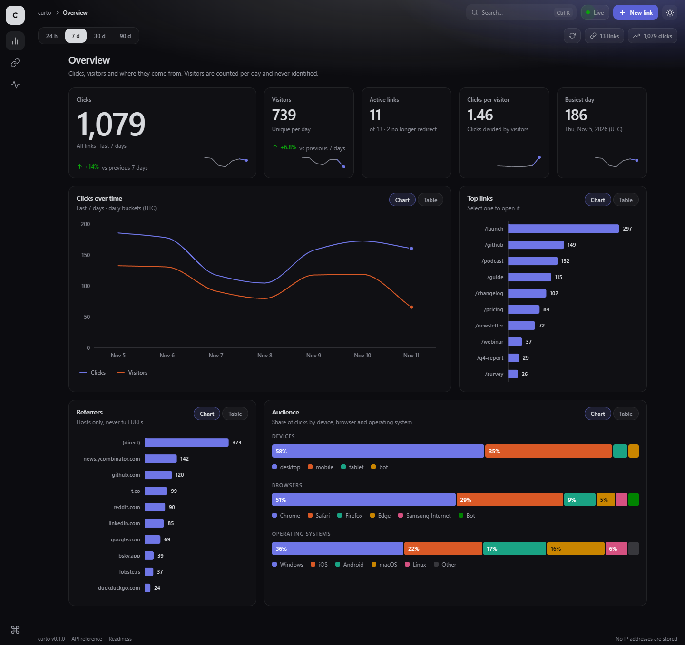
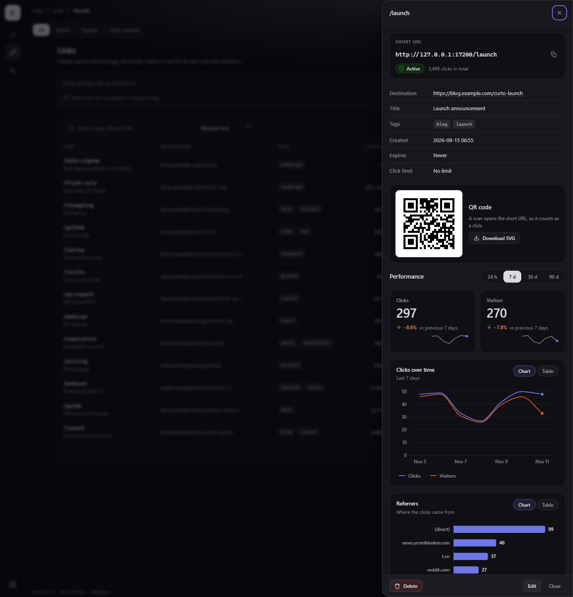
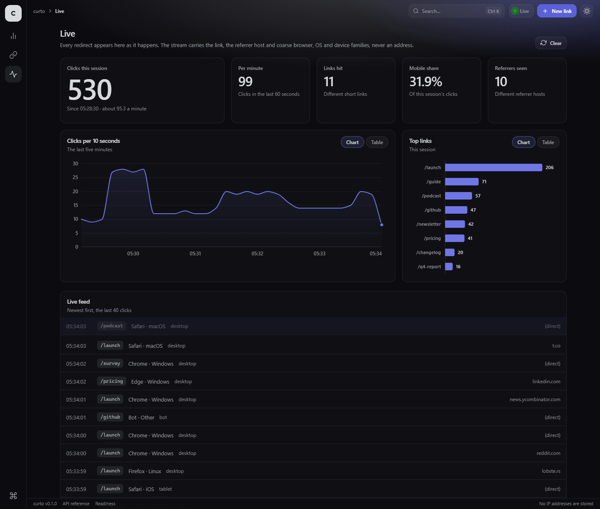
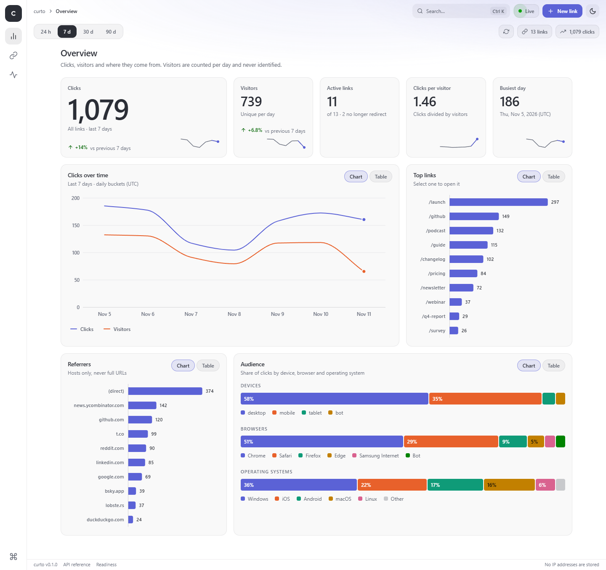
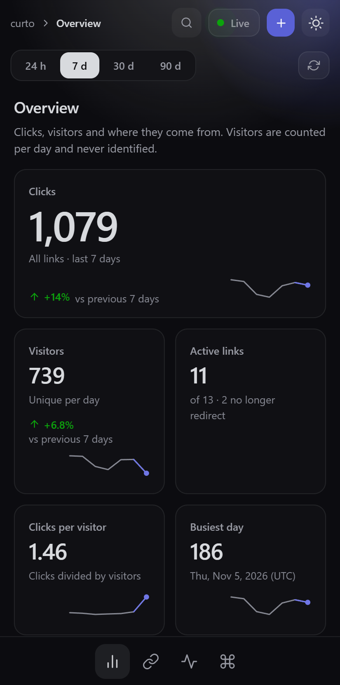
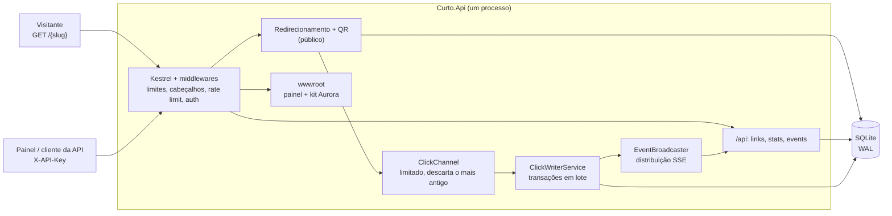

<p align="center"></p>

<p align="center">
  <b>Um encurtador de URLs auto-hospedado que mostra o que está acontecendo agora, sem guardar quem está fazendo.</b>
</p>

<p align="center">
  
  
  
  <a href="https://github.com/q6r/curto/actions/workflows/ci.yml"></a>
</p>

<p align="center"><a href="README.md">English</a> · Português</p>

<p align="center"></p>

## Por que curto

- **Privacidade por construção.** Nenhum endereço IP, nenhum User-Agent bruto e nenhum cookie é guardado. Um visitante é
  um hash de 64 bits misturado com um sal aleatório que muda a cada dia UTC e nunca toca o disco: ele não pode ser
  ligado de um dia para o outro nem recalculado depois. O que fica registrado está em
  [docs/privacy.md](docs/privacy.md) (em inglês).
- **Ao vivo, não "os números de ontem".** Cada redirecionamento aparece no painel em uma fração de segundo por meio de
  um fluxo Server-Sent Events, e o redirecionamento em si nunca espera o clique ser gravado.
- **Pequeno o bastante para confiar.** Um processo ASP.NET Core 9, um arquivo SQLite, sem broker e sem servidor de
  cache. Uma Content Security Policy rígida, sem script nem estilo inline, autenticação por chave de API com comparação
  em tempo constante, limites de requisições por cliente e testes que cobrem os caminhos de erro.

## Recursos

- **Links curtos.** Slugs aleatórios de 7 caracteres ou personalizados, títulos, tags, data de expiração e limite de
  cliques ("vale por 100 cliques"), atualização por JSON merge patch e QR codes escaláveis em SVG.
- **Análises.** Cliques e visitantes diários das últimas 24 horas, 7, 30 ou 90 dias, comparados com o período anterior,
  além de origens (referrers), navegadores, sistemas operacionais e dispositivos. Por link ou para todos os links.
- **Visão ao vivo.** Fluxo de cliques por SSE com heartbeat, controle de pressão e proteção contra consumidores lentos.
  O painel lê o fluxo com `fetch()` e reconecta com espera exponencial.
- **Painel.** Aplicação de página única responsiva feita com o kit de interface Aurora que acompanha o repositório, sem
  etapa de build e sem nenhuma requisição externa: uma barra de navegação à esquerda, trilha de navegação, busca e o
  estado ao vivo no topo, uma barra secundária com os controles da tela atual, cartões planos sobre um único fundo e
  uma barra de status, na paleta Prism Classic (Prism Daylight no tema claro). *Visão geral*: um seletor de período,
  números principais com indicadores de variação, cliques ao longo do tempo, links mais clicados, origens e o perfil
  da audiência. *Links*: cole uma URL para encurtá-la, busque, filtre por status ou tag, ordene e pagine pela API,
  criar, editar e apagar, e uma gaveta por link com o QR code e os gráficos. *Ao vivo*: contadores, um gráfico e um
  feed que se movem conforme os cliques chegam. Temas escuro e claro, paleta de comandos (`Ctrl+K`), uma visão em
  tabela atrás de cada gráfico, acessível pelo teclado, de 360 px para cima.
- **API limpa.** Documento OpenAPI e a referência Scalar em `/docs`, documentos de problema RFC 9457 para todo erro e
  mensagens de validação por campo.
- **Operação.** `/healthz` e `/readyz` (com contadores do pipeline de cliques), encerramento gracioso que grava os
  cliques na fila, limpeza noturna de retenção e imagem Docker sem root com sistema de arquivos raiz somente leitura.

<p align="center">
  
  
</p>
<p align="center">
  
  
</p>

## Início rápido

Você só precisa do [SDK do .NET 9](https://dotnet.microsoft.com/download/dotnet/9.0).

```bash
git clone https://github.com/q6r/curto.git && cd curto
```

Inicie o servidor com uma chave de API (de 16 a 256 caracteres). No macOS e no Linux:

```bash
export CURTO_API_KEY="$(openssl rand -base64 32)"
export ASPNETCORE_URLS=http://127.0.0.1:5080
dotnet run --project src/Curto.Api
```

No Windows PowerShell:

```powershell
$bytes = New-Object byte[] 32; [Security.Cryptography.RandomNumberGenerator]::Create().GetBytes($bytes)
$env:CURTO_API_KEY = [Convert]::ToBase64String($bytes)
$env:ASPNETCORE_URLS = "http://127.0.0.1:5080"
dotnet run --project src/Curto.Api
```

```text
2026-11-10 22:16:34 info: Curto.Api.Storage.Database[10] Database schema is at version 1
2026-11-10 22:16:34 info: Microsoft.Hosting.Lifetime[14] Now listening on: http://127.0.0.1:5080
2026-11-10 22:16:34 info: Microsoft.Hosting.Lifetime[0] Application started. Press Ctrl+C to shut down.
```

Abra <http://127.0.0.1:5080/>, cole a chave quando o painel pedir (ela fica só no `sessionStorage` e não é gravada em
nenhum outro lugar) e crie seu primeiro link. A referência interativa da API está em <http://127.0.0.1:5080/docs>. O
arquivo SQLite é criado em `src/Curto.Api/data/curto.db`; aponte `CURTO_DB_PATH` para outro lugar se preferir.

Quer gráficos que não estejam vazios? Em um segundo terminal, rode um script de exemplo com a mesma chave. Ele cria uma
dúzia de links e simula visitas variadas (navegadores, dispositivos, origens, visitantes que voltam, um link que fica
sem cliques, outro que expira) pela API HTTP de verdade:

```bash
CURTO_API_KEY="<a chave>" ./examples/seed.sh http://127.0.0.1:5080 100
```

```powershell
$env:CURTO_API_KEY = "<a chave>"; ./examples/seed.ps1 -BaseUrl http://127.0.0.1:5080 -Clicks 100
```

O limite padrão é de 120 redirecionamentos por minuto por endereço de cliente, então o script espera sempre que o
servidor responde `429`. Inicie o servidor com `CURTO_RATE_LIMIT_REDIRECT_PER_MINUTE=100000` para popular na hora. As
visitas são sempre carimbadas com o horário atual; a pasta [`examples/`](examples) também traz uma ferramenta pequena
que recua no tempo um banco de demonstração e o preenche com 90 dias de histórico, que foi como as capturas de tela
acima foram feitas.

**Rodar uma versão publicada** (o que o contêiner faz):

```bash
dotnet publish src/Curto.Api -c Release -o out
cd out && CURTO_API_KEY="<a chave>" ASPNETCORE_URLS=http://127.0.0.1:5080 dotnet Curto.Api.dll
```

O repositório inclui um `Dockerfile` e um `docker-compose.yml` (imagem chiseled sem root, sistema de arquivos raiz
somente leitura, volume para o arquivo SQLite e um health check que dispensa `curl`). O CI constrói a imagem e a testa a
cada push; veja os comentários no topo do arquivo compose. Colocar o curto atrás de um proxy que termina TLS exige duas
configurações, descritas em [docs/reverse-proxy.md](docs/reverse-proxy.md) (em inglês).

## Uso

Tudo em `/api` exige a chave no cabeçalho `X-API-Key`. O redirecionamento, o QR code e as sondas de saúde são públicos.
Os exemplos abaixo vêm de uma execução real de [`examples/curl.sh`](examples/curl.sh) (e de
[`curl.ps1`](examples/curl.ps1) e [`curto.http`](examples/curto.http)); o [docs/api.md](docs/api.md) (em inglês) é o
tour rápido de todos os endpoints e convenções.

**Criar um link**

```bash
curl -s -X POST $BASE/api/links -H "X-API-Key: $CURTO_API_KEY" -H "Content-Type: application/json" \
    -d '{"url":"https://example.com/blog/hello-world","slug":"tour","title":"Guided tour","tags":["blog","demo"]}'
```

```json
{"slug":"tour","shortUrl":"http://127.0.0.1:5080/tour","url":"https://example.com/blog/hello-world","title":"Guided tour","tags":["blog","demo"],"createdAt":"2026-11-11T01:14:15Z","expiresAt":null,"maxClicks":null,"clicks":0,"status":"active"}
```

**Seguir o link.** A resposta é um `302` que nunca é cacheado; o clique é registrado em segundo plano.

```bash
curl -s -i $BASE/tour -H "Referer: https://news.ycombinator.com/item?id=1"
```

```text
HTTP/1.1 302 Found
Cache-Control: no-store
Location: https://example.com/blog/hello-world
```

**Os erros são explicados por campo** (`400`; um slug já usado é um `409` com `"code":"slug_taken"`; sem chave é `401`):

```json
{"type":"https://tools.ietf.org/html/rfc9110#section-15.5.1","title":"One or more validation errors occurred.","status":400,"detail":"See the errors member for details.","instance":"/api/links","errors":{"url":["url must be an absolute http or https URL."],"slug":["slug must be 3-32 characters from A-Z, a-z, 0-9, '_' and '-'."],"tags":["each tag must be 1-32 letters, digits, '-', '_', '.' or ':'."]},"traceId":"00-4ef4d7e613a2392cbbc1c77cabbb991f-a24fa9ebe98e9ed1-00","correlationId":"01a1c82b7d0777e19d49babaea082ad8"}
```

As mensagens de erro da API estão em inglês.

**Atualizar com JSON merge patch** (campos presentes mudam, `null` limpa, campos ausentes ficam como estão):

```bash
curl -s -X PATCH $BASE/api/links/tour -H "X-API-Key: $CURTO_API_KEY" -H "Content-Type: application/json" \
    -d '{"title":"Guided tour (edited)","maxClicks":50}'
```

**Estatísticas.** `range` é `24h`, `7d`, `30d` ou `90d`; a série vem preenchida com zeros e a resposta traz os mesmos
números da janela anterior, de onde o painel tira as variações (a série foi omitida aqui):

```bash
curl -s "$BASE/api/links/tour/stats?range=24h" -H "X-API-Key: $CURTO_API_KEY"
```

```json
{"range":{"from":"2026-11-10T02:00:00Z","to":"2026-11-11T02:00:00Z","bucket":"hour"},"links":{"total":1,"active":1,"expired":0},"clicks":{"inRange":1,"previous":0},"visitors":{"inRange":1,"previous":0},"series":[…],"topLinks":[{"slug":"tour","title":"Guided tour (edited)","url":"https://example.com/blog/hello-world","clicks":1}],"referrers":[{"name":"news.ycombinator.com","clicks":1}],"devices":[{"name":"desktop","clicks":1}],"browsers":[{"name":"Firefox","clicks":1}],"os":[{"name":"Linux","clicks":1}]}
```

**Ver os cliques chegando.** O `EventSource` não consegue enviar cabeçalhos; leia o fluxo com `curl -N` ou `fetch()`:

```bash
curl -N -H "X-API-Key: $CURTO_API_KEY" $BASE/api/events
```

```text
retry: 5000
: connected

event: click
data: {"slug":"hello","at":"2026-11-11T01:10:51.629018Z","referrer":"linkedin.com","browser":"Safari","os":"iOS","device":"mobile"}
```

Não existe campo capaz de carregar um endereço, e o hash do visitante não faz parte do evento.

**Saúde e o pipeline de cliques** (`GET /readyz`, público):

```json
{"status":"ready","version":"0.1.0","database":"ok","clickQueue":{"depth":0,"capacity":10000,"enqueued":2,"persisted":2,"dropped":0,"failed":0},"liveSubscribers":0,"slowConsumersDropped":0}
```

### Endpoints

| Método e caminho | Auth | O que faz |
|---|---|---|
| `GET /{slug}` | público | `302` para o destino, ou `404` / `410` (expirado, limite de cliques atingido). Registra um clique. |
| `HEAD /{slug}` | público | Mesma resposta, não registra nada (verificadores de link e pré-visualizações). |
| `GET /qr/{slug}.svg` | público | QR code da URL curta. `size` de 64 a 2048, `dark` e `light` como cores hexadecimais. |
| `POST /api/links` | chave | Cria um link (`url`, e opcionais `slug`, `title`, `tags`, `expiresAt`, `maxClicks`). |
| `GET /api/links` | chave | Lista: `query`, `tag`, `status`, `sort` (`createdAt`, `clicks`), `dir`, `limit` (1-200), `offset`. |
| `GET /api/links/{slug}` | chave | Um link. |
| `PATCH /api/links/{slug}` | chave | JSON merge patch. O slug em si não muda. |
| `DELETE /api/links/{slug}` | chave | Apaga o link e as linhas de cliques dele. |
| `GET /api/stats/overview` | chave | Análises de todos os links. |
| `GET /api/links/{slug}/stats` | chave | Análises de um link, no mesmo formato. |
| `GET /api/events` | chave | Fluxo ao vivo de cliques (SSE). |
| `GET /healthz`, `GET /readyz` | público | Liveness, e readiness com contadores do pipeline. |
| `GET /docs`, `GET /openapi/v1.json` | público | Referência Scalar e o documento OpenAPI. |

## Arquitetura



Um redirecionamento faz uma leitura indexada e uma escrita não bloqueante no canal, e responde. Um escritor em segundo
plano agrupa os eventos em transações únicas e entrega cada um aos assinantes ao vivo. Quando o escritor atrasa, o
evento mais antigo da fila é descartado e contado em `/readyz`; o visitante nunca percebe. A história completa, com
diagramas de sequência do pipeline de cliques e do fluxo ao vivo, está em
[docs/architecture.md](docs/architecture.md) (em inglês).

## Estrutura do projeto

```text
curto/
├── src/Curto.Api/             o serviço (ASP.NET Core 9, minimal APIs)
│   ├── Endpoints/             grupos de rotas: links, stats, events, redirecionamento, QR, saúde
│   ├── Services/              casos de uso, pipeline de cliques, parsers, validadores
│   ├── Storage/               acesso ao SQLite e migrações de schema
│   ├── Infrastructure/        opções, auth, rate limits, cabeçalhos de segurança, documentos de problema
│   ├── Models/                DTOs e registros de domínio
│   └── wwwroot/               o painel: index.html, app.js, app.css e o kit de interface Aurora incluído
├── tests/Curto.Api.Tests/     xUnit: API, segurança, privacidade, SSE, pipeline de cliques, arquivos do painel
├── examples/                  arquivo .http, tours com curl, scripts de seed, Curto.DemoHistory (dados de demonstração com histórico)
├── docs/                      arquitetura, configuração, privacidade, tour da API, proxy reverso, capturas de tela
├── assets/banner.svg
├── Dockerfile  docker-compose.yml  .dockerignore
└── .github/                   CI, Dependabot, modelos de issue e de pull request
```

## Configuração

As configurações vêm do `appsettings.json`, de variáveis de ambiente `Curto__Nome` e dos apelidos `CURTO_*` abaixo.
Cada opção, sua faixa e seu padrão estão em [docs/configuration.md](docs/configuration.md) (em inglês); um valor
inválido interrompe o processo na inicialização e o erro aponta todos os problemas de uma vez.

| Variável de ambiente | Padrão | Significado |
|---|---|---|
| `CURTO_API_KEY` | nenhum | **Obrigatória** fora do Development. De 16 a 256 caracteres imprimíveis. Enviada como `X-API-Key`. |
| `CURTO_BASE_URL` | derivada da requisição | Origem pública das URLs curtas, por exemplo `https://s.example.com`. Defina em produção. |
| `CURTO_DB_PATH` | `data/curto.db` | Arquivo SQLite. O diretório precisa ser gravável (o modo WAL cria os arquivos `-wal` e `-shm`). |
| `CURTO_BLOCK_PRIVATE_TARGETS` | `false` | Recusa destinos em loopback, redes privadas ou hosts só locais. |
| `CURTO_RETENTION_DAYS` | `180` | Linhas de cliques mais antigas que isso são removidas à noite. Os contadores acumulados ficam. |
| `CURTO_RATE_LIMIT_REDIRECT_PER_MINUTE` | `120` | Por endereço de cliente: redirecionamentos e QR codes. |
| `CURTO_RATE_LIMIT_CREATE_PER_MINUTE` | `20` | Por endereço de cliente: criação de links. |
| `CURTO_RATE_LIMIT_API_PER_MINUTE` | `300` | Por endereço de cliente: todas as outras chamadas a `/api`. |
| `ASPNETCORE_URLS` | `http://localhost:5000` | Onde o Kestrel escuta. Use loopback, a menos que um proxy precise de mais. |

## Notas de segurança

- **Autenticação.** Uma única chave de API compartilhada no cabeçalho `X-API-Key`, nunca na query string. A chave
  recebida e a esperada passam por SHA-256 e depois são comparadas em tempo constante. O painel guarda a chave só no
  `sessionStorage`.
- **Endurecimento do navegador.** `Content-Security-Policy: default-src 'self'; script-src 'self'; style-src 'self'` no
  painel e na API, `nosniff`, `X-Frame-Options: DENY`, um `Referrer-Policy` rígido e nenhum cabeçalho CORS. Só o `/docs`
  recebe um nonce por requisição e uma exceção de estilo, porque o bundle do Scalar injeta estilos. O painel nunca monta
  marcação a partir de dados (todo texto passa por `textContent`), e os testes falham se ele ganhar script inline,
  estilo inline ou uma requisição para outra origem.
- **Entrada.** As URLs de destino precisam ser `http(s)` absolutas, com no máximo 2048 caracteres, sem credenciais, e
  são normalizadas para ASCII. Slugs têm de 3 a 32 caracteres de `A-Za-z0-9_-` e as palavras que colidem com rotas são
  reservadas. Propriedades JSON desconhecidas são rejeitadas, o corpo das requisições é limitado (16 KiB por padrão) e o
  SQL é sempre parametrizado.
- **Abuso.** Limites de requisições de janela fixa por endereço de cliente (IPv6 por /64).
  `CURTO_BLOCK_PRIVATE_TARGETS=true` recusa destinos que apontam para loopback, redes privadas ou endereços só locais.
- **Limites, com franqueza.** O curto não termina TLS: coloque um proxy reverso na frente e leia
  [docs/reverse-proxy.md](docs/reverse-proxy.md) para que os limites e os hashes de visitante vejam o endereço real do
  cliente. Há uma única chave e não há contas de usuário. O `BLOCK_PRIVATE_TARGETS` olha endereços literais e nomes
  locais conhecidos; ele nunca resolve DNS, então um nome público que resolve para um endereço privado não é pego.

Relate vulnerabilidades de forma privada, como descrito em [SECURITY.md](SECURITY.md).

## Testes

```bash
dotnet build Curto.slnx -c Release -warnaserror
dotnet test Curto.slnx -c Release
dotnet format Curto.slnx --verify-no-changes
```

681 testes, offline, cerca de cinco segundos. A aplicação real é hospedada em memória com um arquivo SQLite isolado por
classe de teste, um relógio falso e gravação rápida de cliques. Além dos caminhos felizes, a suíte cobre validação e
entrada hostil, autenticação, limites de requisições, cabeçalhos de segurança, privacidade (nada que identifique chega
ao banco), expiração e limites de cliques sob concorrência, o pipeline de cliques e seu comportamento em estouro,
encerramento gracioso, retenção, SSE e a camada estática do painel: tipos de conteúdo, cabeçalhos de cache com
revalidação, a política rígida, nenhum código inline, nenhuma origem externa, a garantia de que a página deixa seus
marcos de navegação para o `Aurora.shell()` e de que todo destino da barra lateral tem uma tela, e de que todo caminho
da API que o painel chama existe no documento OpenAPI.

O painel em si não tem testes unitários de JavaScript. Ele foi exercitado no Chrome headless (criar, editar e apagar um
link, um fluxo ao vivo que sobrevive a um reinício do servidor, temas claro e escuro, de 360 px a 1440 px).

## Roteiro

- Mais de uma chave de API, com rótulos e rotação.
- Uma lista de proxies confiáveis no lugar da chave tudo-ou-nada `ASPNETCORE_FORWARDEDHEADERS_ENABLED`.
- Exportação CSV e JSON das estatísticas agregadas.
- Um mapa de calor de dia da semana por hora. Os endpoints de estatísticas devolvem buckets por hora só para as últimas
  24 horas e por dia além disso, então a matriz precisa de um agregado dedicado.
- Uma imagem de contêiner publicada e um fluxo de release.

## Contribuindo

Issues e pull requests são bem-vindos. Comece pelo [CONTRIBUTING.md](CONTRIBUTING.md) (em inglês): preparação do
ambiente, testes, lint e estilo de commit. Mudanças que preservam a privacidade e a CSP rígida são as mais fáceis de
aceitar.

## Licença

[MIT](LICENSE) © 2026 q6r

## Créditos e inspiração

O painel é construído sobre o kit de interface Aurora que acompanha o `wwwroot` (sem dependências, MIT, parte deste
repositório). A referência da API é o [Scalar](https://github.com/scalar/scalar) e os QR codes vêm do
[QRCoder](https://github.com/codebude/QRCoder). A ideia do visitante com sal diário segue as ferramentas de análise que
respeitam a privacidade, como Plausible e Fathom, e o formato do produto deve muito aos encurtadores auto-hospedados
que vieram antes (Shlink, YOURLS, Kutt). Nenhum deles é afiliado a este projeto.
