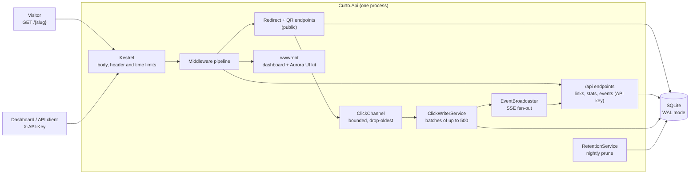
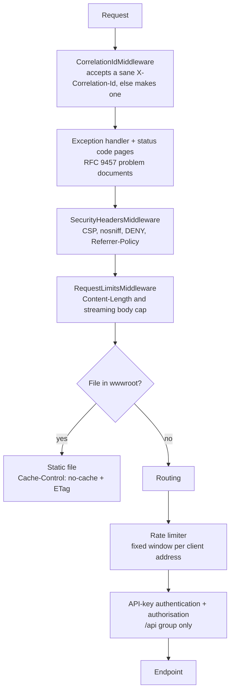
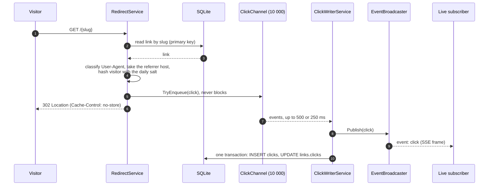
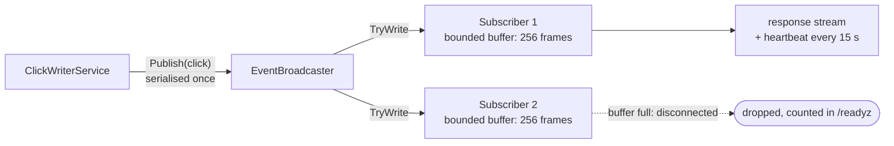
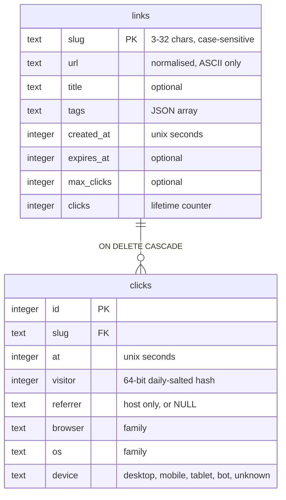

# Architecture

curto is one ASP.NET Core 9 process and one SQLite file. There is no queue broker, no cache server and no
separate worker: the pieces below run inside the same host.



## Request path

Every request passes the same middleware in this order. The order is deliberate: static files are served
before routing, so the `/{slug}` route can never shadow `index.html`, and rate limiting and authorisation run
after routing because they need the matched endpoint.



| Concern | Where | Behaviour |
|---|---|---|
| Errors | `GlobalExceptionHandler`, `Problems` | Every error leaves as `application/problem+json` with `type`, `title`, `status`, `traceId` and `correlationId`. |
| Auth | `ApiKeyAuthentication` | `X-API-Key` header only (never a query string). The candidate and the expected key are SHA-256 hashed, then compared in constant time. |
| Rate limits | `RateLimiting` | Three independent budgets per client: redirects and QR codes, link creation, other API calls. IPv6 clients share one budget per /64. |
| Headers | `SecurityHeadersMiddleware` | `script-src 'self'; style-src 'self'` everywhere. Only `/docs` gets a per-request nonce and a style exception, because the Scalar bundle injects styles. |
| Cache | endpoints | `/api/*` and redirects answer `no-store`; static files answer `no-cache` and revalidate with their ETag. |

## The click pipeline

A redirect must stay fast even when the disk is slow. The hot path therefore does one indexed read and one
non-blocking channel write. Persisting the click and notifying live viewers happen afterwards, off the request.



- **The raw IP address and the raw User-Agent never leave `RedirectService.Describe`.** They are turned into a
  64-bit daily-salted hash and three coarse labels before the event is queued. See [privacy.md](privacy.md).
- **Back-pressure never reaches the visitor.** `ClickChannel` is bounded (default 10 000). When the writer falls
  behind, the *oldest* queued event is dropped and counted; `/readyz` exposes `enqueued`, `persisted`, `dropped`
  and `failed`.
- **Batching.** The writer groups events into one transaction (at most `BatchSize`, or whatever arrived within
  `FlushIntervalMs`). A failing batch is attempted up to three times with back-off, then counted as `failed`; the
  loop itself never dies.
- **Click budgets are the one synchronous exception.** A link with `maxClicks` spends its budget with an atomic
  `UPDATE ... WHERE clicks < max_clicks` during the redirect, so the limit is exact even under concurrency.
  Those events are flagged `Counted` so the writer does not increment the counter twice.
- **`HEAD` is not a visit.** Link checkers and preview bots get the same answer but record nothing and spend
  no budget.
- **Graceful shutdown.** `StopAsync` completes the channel and the writer drains it, so clicks that were queued
  when the process received SIGTERM are still written.

## Live stream (SSE)

`GET /api/events` is a Server-Sent Events stream. `EventSource` cannot send headers, so clients read it with
`fetch()` and a stream reader (the dashboard does exactly that, with exponential back-off on reconnect).



The payload carries `slug`, `at`, `referrer`, `browser`, `os` and `device`. The visitor hash is deliberately
left out, and there is no field that could hold an address. At most `SseMaxSubscribers` (default 100) streams
are open at once; more get `503` with `Retry-After`.

## Data model



Migrations are an append-only list of scripts; each one ends with `PRAGMA user_version = n`, so the file records
how far it got. The database runs in WAL mode: readers (stats, the dashboard) proceed while the single writer
commits. `RetentionService` deletes click rows older than `RetentionDays` in chunks of 5 000, shortly after
start-up and then every night at 03:00 UTC. The lifetime counters on `links` are not affected.

## Statistics

`/api/stats/overview` and `/api/links/{slug}/stats` share one shape. Windows are aligned to whole UTC buckets:
`24h` uses 24 hourly buckets, `7d`, `30d` and `90d` use daily buckets, and the last bucket always contains the
current time. The series is zero-filled, and the response also carries the same measure for the window right
before the requested one, which is what the dashboard's deltas are computed from. Ranked lists are capped at ten
entries. All aggregates of one response are read inside a single read transaction, so they agree with each other.

## The dashboard

`src/Curto.Api/wwwroot` holds a static single-page dashboard built on the bundled Aurora UI kit (three files:
`aurora.css`, `aurora.js`, `aurora-charts.js`) plus `index.html`, `app.css` and `app.js`. It has no build
step, no CDN and no web fonts, and it runs under the strict policy `default-src 'self'; script-src 'self';
style-src 'self'` because it never writes inline `<script>`, `<style>`, `style=""` attributes or inline handlers.
The API key lives in `sessionStorage` only and is sent as `X-API-Key`.

`index.html` is almost empty: `Aurora.shell()` builds the page and `app.js` renders the views into it. The shell has a
rail with the three destinations (Overview, Links, Live) and the command palette, a top bar (breadcrumbs, search, the
live state of the click stream, "New link", theme toggle), a sub bar that each view fills with its own controls (the
range switch and counts on Overview, the status filter on Links) and a status bar (version, API reference, readiness,
the privacy note). Routes are hash fragments: `#/overview`, `#/links`, `#/links/{slug}` (opens the drawer of that
link) and `#/live`.

## Project layout and boundaries

```text
src/Curto.Api/
  Program.cs                 composition root, plus the --healthcheck entry point
  Endpoints/                 one file per route group; no business logic
  Services/                  link, redirect and stats use cases, click pipeline, parsers, validators
  Storage/                   SQLite access: Database, repositories, schema migrations
  Infrastructure/            options, auth, rate limiting, security headers, problem documents
  Models/                    DTOs and domain records
  wwwroot/                   the dashboard
```

Endpoints depend on services, services on repositories, and nothing in `Storage` knows about HTTP. All settings
are bound once into `CurtoOptions` and validated at start-up, so a bad value stops the process with one message
per problem instead of failing later.
